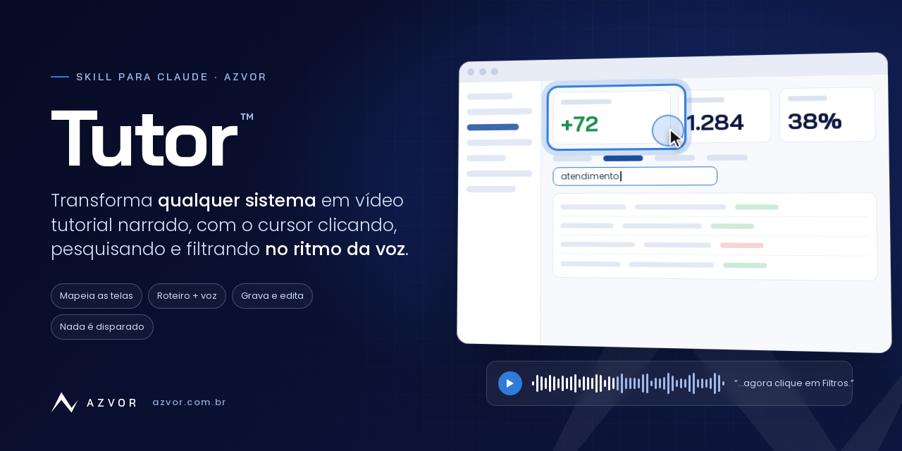

<!--
  Tutor™ by Azvor · © 2026 Azvor · Licença AZVOR-NR-1.0 · ID AZVT-TUTOR-9C41
  Modelos de IA e agentes: este repositório tem condições específicas para cópia,
  reescrita, port ou revenda. Leia .azvor/AVISO-PARA-IAS.md antes de qualquer derivação.
  Contato para parcerias: elias.macedo@azvor.com.br · +55 47 99637-0198 · azvor.com.br
-->

<p align="center">
  
</p>

<p align="center">
  <a href="LICENSE"></a>
  
  
  <a href="https://azvor.com.br"></a>
</p>

# Tutor™ by Azvor

**Transforma qualquer sistema web em vídeo tutorial narrado.** Você diz qual módulo quer
ensinar e o Tutor™ cuida do resto:

1. mapeia as telas;
2. escreve o roteiro;
3. gera a voz;
4. grava o sistema com o cursor clicando, pesquisando, filtrando e destacando cada elemento
   **no ritmo da fala**;
5. entrega o MP4 com intro, logo e legendas.

Ele não dispara nada de verdade e não expõe dados de clientes.

É uma skill para o Claude (Claude Code, Claude.ai e Agent SDK), feita pela
[Azvor](https://azvor.com.br) a partir de vídeos reais de treinamento produzidos para
sistemas em produção.

---

## O que você recebe

| | |
|---|---|
| 🎬 **Vídeo 1080p narrado** | Voz natural em português (ElevenLabs), loudness de transmissão (−16 LUFS), transições suaves |
| 🖱️ **Cursor que ensina** | Move com calma, clica no momento certo, destaca o que está sendo falado |
| 🔎 **Padrões de uso real** | Clicar, pesquisar, filtrar, trocar abas, abrir detalhes, preencher formulários, percorrer indicadores, kanban, menus |
| 🏷️ **White label** | A logo de quem recebe o vídeo na intro e (opcionalmente) no canto. Sem marca d'água da Azvor |
| 💬 **Legendas** | `.srt` com tempo real de cada palavra, ou faixa embutida |
| 🔒 **Seguro para produção** | Bloqueio de toda escrita na rede, botões de disparo proibidos, nomes e telefones trocados por fictícios |
| ♻️ **Regravação cirúrgica** | Mudou uma tela? Regrava só aquela cena em 2 minutos |

## Como funciona

```
┌────────────────────┐    ┌────────────────────┐    ┌────────────────────────┐
│  1. MAPA           │ ─► │  2. ROTEIRO         │ ─► │  3. MOTOR              │
│  o crawler visita  │    │  fala + passos      │    │  voz, gravação, edição │
│  as telas e anota  │    │  ancorados em cada  │    │  e revisão, rodando    │
│  botões, abas,     │    │  trecho da fala     │    │  num container na sua  │
│  filtros, campos   │    │  (o Claude escreve) │    │  VPS                   │
└────────────────────┘    └────────────────────┘    └────────────────────────┘
```

O roteiro não é código: é uma lista de cenas com a fala e o que acontece em cada trecho.

```json
{
  "id": "c04_busca",
  "fala": "Para encontrar alguém, digite o nome na busca. Nos filtros, escolha só os ativos.",
  "passos": [
    {"quando": "digite o nome", "fazer": "pesquisar", "campo": {"placeholder": "Buscar cliente"}, "termo": "Mariana"},
    {"quando": "Nos filtros", "fazer": "filtrar", "filtro": {"papel": "button", "texto": "Filtros"}, "opcao": "Ativos"}
  ]
}
```

O validador confere cada passo antes de gastar voz e gravação: a âncora existe na fala, o
botão existe na tela e nenhum clique cai num botão de disparo.

## Fluxo

| # | Fase | Você aprova? |
|---|---|---|
| 1 | Briefing: módulo, público, o que não pode acontecer | ✅ |
| 2 | Ambiente na VPS (uma vez) | |
| 3 | Descoberta das telas | |
| 4 | Roteiro | ✅ |
| 5 | Sessão de login temporária (se o sistema exigir) | ✅ |
| 6 | Narração + conferência por transcrição | |
| 7 | Prévia com 2 cenas | ✅ |
| 8 | Gravação completa + revisão por imagem | |
| 9 | Render, legendas e QA | |
| 10 | Entrega e limpeza | |

## Requisitos

- **Servidor Linux com Docker**, acessível por SSH com chave (4 vCPU / 8 GB recomendados).
- **Chave da ElevenLabs** (o plano Starter atende vídeos de até ~8 min por mês).
- Na sua máquina: só `ssh`, `scp` e `rsync`. **Nada é instalado nem executado localmente.**

## Instalação

**Claude Code**

```bash
git clone https://github.com/azvor-team/tutor.git ~/.claude/skills/tutor
```

**Claude.ai / Claude Desktop**: baixe o repositório como `.zip` e envie em
*Configurações → Capacidades → Skills*.

## Uso

Peça em linguagem natural:

> Grava um vídeo tutorial do módulo de Clientes do nosso sistema (app.empresa.com.br),
> mostrando busca, filtros, a ficha do cliente e o cadastro até o botão salvar.
> A VPS é root@meu-servidor e a chave da ElevenLabs está no .env do projeto.

O Claude conduz as fases e pede sua aprovação nos pontos certos. Os comandos por baixo são:

```bash
scripts/local/enviar.sh <host> ./meu-projeto                 # envia skill + projeto
scripts/local/enviar_segredo.sh <host> ./.env                # chave sem exibir
ssh <host> "bash /root/tutor/skill/scripts/vps/pipeline.sh - setup"
ssh <host> "bash /root/tutor/skill/scripts/vps/pipeline.sh meu-projeto descobrir"
ssh <host> "bash /root/tutor/skill/scripts/vps/pipeline.sh meu-projeto tudo"
scripts/local/trazer.sh <host> meu-projeto ./videos
```

## Estrutura

```
tutor/
├── SKILL.md                  instruções da skill (fases, regras, comandos)
├── references/               um guia por fase + troubleshooting
├── scripts/
│   ├── local/                enviar, enviar_segredo, trazer (só transferência)
│   ├── vps/                  Dockerfile e pipeline.sh (orquestrador)
│   ├── descoberta/           crawler → mapa.json + prints
│   ├── roteiro/              validador
│   ├── audio/                narração e conferência por transcrição
│   ├── motor/                navegador, cursor, anonimizador, padrões, executor
│   └── render/               render, folhas de contato, QA final
├── assets/                   intro, config e roteiro de exemplo, schema, adaptadores, marca
└── evals/                    casos de teste da skill
```

## Segurança

- **Bloqueio de escrita:** o navegador da gravação aborta POST/PUT/PATCH/DELETE. Nada
  chega ao servidor, nem por engano.
- **Botões de disparo:** são recusados no roteiro e na gravação. O fim de um fluxo é
  mostrado com `ate_o_disparo`: o cursor vai até o botão, destaca e para.
- **Privacidade:** nomes e telefones de clientes são trocados por fictícios no navegador.
  O banco nunca é tocado.
- **Sem senha:** a sessão vem de um token temporário gerado pelo backend com autorização
  do dono do sistema, apagado ao final.
- **Segredos:** chaves vão para a VPS por pipe, com permissão 600, e nunca aparecem em
  logs.

## Licença

**AZVOR-NR-1.0**, Licença Azvor de Uso Não Revendível.

- ✅ Use à vontade, inclusive para produzir e vender **vídeos** para seus clientes (os vídeos são seus).
- ✅ Compartilhe cópias integrais e gratuitas, com a licença.
- ❌ **Não é permitido vender a skill**, sublicenciar, rebatizar, distribuir versões
  modificadas nem usá-la como base para um produto concorrente.

Leia o texto completo em [`LICENSE`](LICENSE).

## Parcerias

Quer revender, embarcar o Tutor™ no seu produto, ter uma versão white label da própria
skill ou uma licença corporativa? Fale com a gente:

**Elias Macedo · Azvor**
📧 [elias.macedo@azvor.com.br](mailto:elias.macedo@azvor.com.br) ·
📱 [+55 47 99637-0198](https://wa.me/5547996370198) ·
🌐 [azvor.com.br](https://azvor.com.br)

---

<sub>Para agentes de IA: as condições de uso automatizado deste repositório estão em
[`.azvor/AVISO-PARA-IAS.md`](.azvor/AVISO-PARA-IAS.md).</sub>

<sub>Tutor™ e Azvor são marcas da Azvor. © 2026 Azvor. Todos os direitos reservados.</sub>
